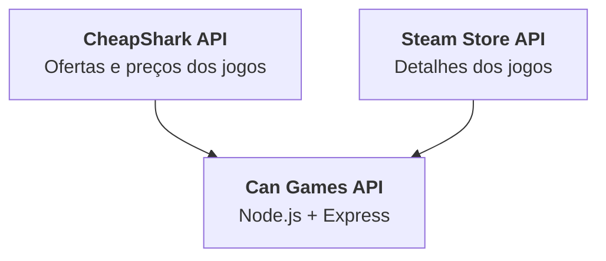

# Can Games API

A **Can Games API** é uma API REST desenvolvida em JavaScript com Node.js e Express. Ela reúne informações de jogos e ofertas por meio das APIs da [CheapShark](https://www.cheapshark.com/api) e da [Steam Store](https://store.steampowered.com/api), disponibilizando os dados em um formato organizado para consumo pelo front-end.

Além da consulta ao catálogo, a API oferece funcionalidades de cadastro e autenticação de usuários, carrinho, lista de desejos, biblioteca e pedidos. O projeto tem finalidade acadêmica e utiliza armazenamento temporário em memória, sem banco de dados.

## 🎮 Funcionalidades

- Consulta e pesquisa de jogos, com filtros, paginação e ordenação.
- Exibição de preços, descontos, imagens, gêneros, avaliações e detalhes dos jogos.
- Cadastro, login, logout e gerenciamento do perfil de usuário.
- Gerenciamento de carrinho e lista de desejos.
- Consulta da biblioteca e registro da última vez em que um jogo foi executado.
- Finalização simulada de pedidos, com inclusão dos jogos comprados na biblioteca.
- Proteção de rotas, validação de dados e tratamento padronizado de erros.

## 🛠️ Tecnologias

| Tecnologia | Utilização |
|---|---|
| JavaScript (ES Modules) | Linguagem e organização dos módulos |
| Node.js 20+ | Ambiente de execução |
| Express 4 | Criação do servidor e das rotas HTTP |
| CheapShark API | Consulta de ofertas, preços e informações de vendas |
| Steam Store API | Consulta de detalhes, imagens, gêneros, plataformas e informações complementares dos jogos |
| JSON Web Token (`jsonwebtoken`) | Geração e verificação de tokens de autenticação |
| `bcryptjs` | Hash e verificação de senhas |
| `dotenv` | Leitura das variáveis de ambiente |
| `cors`, `helmet` e `express-rate-limit` | Configurações básicas de segurança e controle de requisições |
| Jest e Supertest | Testes automatizados |
| ESLint e Prettier | Análise e formatação do código |
| Nodemon | Reinicialização automática durante o desenvolvimento |

## 📁 Estrutura do projeto

```text
can-api/
├── src/
│   ├── config/          # Configurações e variáveis de ambiente
│   ├── controllers/     # Controladores das requisições HTTP
│   ├── middlewares/     # Autenticação, validação e tratamento de erros
│   ├── models/          # Modelos e estruturas de armazenamento
│   ├── routes/          # Definição dos endpoints
│   ├── services/        # Regras de negócio e integrações externas
│   ├── utils/           # Funções auxiliares
│   ├── app.js           # Configuração da aplicação Express
│   ├── data.js          # Acesso aos dados em memória
│   └── server.js        # Inicialização do servidor
├── tests/               # Testes automatizados
├── .env                 # Variáveis de ambiente (criado localmente)
├── .gitignore
├── eslint.config.js
├── jest.config.js
├── nodemon.json
├── package.json
└── package-lock.json
```

## 🏗️ Arquitetura e Integrações

A Can Games API consulta duas fontes externas e combina os dados recebidos para disponibilizar informações de jogos, ofertas e preços.



### APIs utilizadas

- **[CheapShark API](https://www.cheapshark.com/api):** fornece ofertas e preços. A integração consulta a loja Steam (`storeID=1`) e utiliza informações como preço, economia/desconto e identificador do jogo na Steam, quando disponível.
- **[Steam Store API](https://store.steampowered.com/api):** complementa os dados dos jogos por meio do endpoint `appdetails`, com informações como descrição, desenvolvedores, publicadoras, gêneros, imagens, plataformas, idiomas, requisitos e preço regional, quando disponível.

A API combina e normaliza os dados recebidos antes de utilizá-los nas respostas. As consultas externas são armazenadas em cache temporário por 10 minutos para reduzir chamadas repetidas.

## 🔐 Autenticação, armazenamento e limitações

### Autenticação

A autenticação utiliza **JWT (JSON Web Token)**. Após o login, a API gera um token assinado com o segredo configurado em `JWT_SECRET`. Nas rotas protegidas, o cliente deve enviá-lo no cabeçalho:

```http
Authorization: Bearer <token>
```

As senhas são armazenadas como hash, utilizando `bcryptjs` com fator de custo 12. A senha original não é armazenada. Além da verificação da assinatura e da validade do JWT, a API verifica se o token ainda está registrado no controle de sessões mantido em memória.

### Armazenamento

Não há integração com banco de dados. Os dados de usuários, sessões, carrinhos, listas de desejos, bibliotecas e pedidos permanecem em estruturas JavaScript na memória do processo Node.js. O cache das consultas às APIs externas também é mantido em memória.

**Consequência:** ao parar ou reiniciar o servidor, os dados armazenados em memória são perdidos. Isso inclui contas cadastradas, hashes de senha, sessões, carrinhos, listas, bibliotecas, pedidos e cache. O armazenamento não é compartilhado entre diferentes instâncias do servidor.

### Limitações e regras de negócio

- **Finalidade acadêmica:** a API é uma implementação demonstrativa, não um serviço de produção.
- **Sem persistência:** não utiliza banco de dados nem grava os dados das funcionalidades da loja em disco.
- **Dependência externa:** a consulta de ofertas e detalhes depende da disponibilidade e das respostas da CheapShark e da Steam Store.
- **Cache temporário:** os resultados externos ficam em cache por até 10 minutos.
- **Preços e moedas:** quando há preço da Steam em BRL, `priceInCents` representa o valor em centavos de real. Se a fonte disponível apresentar outra moeda, a API não realiza conversão cambial e mantém `priceInCents` como `null`. O objeto `price` informa a moeda e a origem do preço.
- **Dados locais:** `unitsSold` e `isFeatured` são valores locais, pois não são fornecidos pelas APIs integradas.
- **Biblioteca:** jogos só são adicionados após a finalização de um pedido. Não existem endpoints para adicionar ou remover jogos diretamente da biblioteca.
- **Pagamento:** a finalização do pedido é simulada. Nenhuma cobrança ou transação financeira real é realizada.
- **Testes:** os testes automatizados existentes não cobrem necessariamente todos os endpoints e cenários. As funcionalidades sem cobertura devem ser verificadas manualmente.

## 🔌 Endpoints

A API utiliza o protocolo HTTP e retorna os dados no formato JSON. A URL-base padrão para execução local é:

```text
http://localhost:4000
```

Todas as rotas funcionais, exceto `/health`, utilizam o prefixo `/api`.

**Sobre a autenticação:**
- **Pública:** não exige token.
- **Obrigatória:** exige um JWT válido no cabeçalho `Authorization`.
- **Opcional:** funciona sem token, associando os dados ao visitante (`guest`); com um token válido, associa os dados ao usuário autenticado.

Nas requisições com corpo JSON, informe o cabeçalho `Content-Type: application/json`.

### Visão geral

| Recurso | Método e endpoint | Autenticação | Finalidade |
|---|---|---|---|
| Health check | `GET /health` | Pública | Verificar se a API está ativa. |
| Jogos | `GET /api/games` | Pública | Listar, pesquisar e filtrar jogos e ofertas. |
| Jogos | `GET /api/games/:identifier` | Pública | Consultar os detalhes de um jogo. |
| Carrinho | `GET /api/cart` | Opcional | Consultar os itens do carrinho. |
| Carrinho | `POST /api/cart` | Opcional | Adicionar um jogo ao carrinho. |
| Carrinho | `DELETE /api/cart/:gameId` | Opcional | Remover um jogo do carrinho. |
| Lista de desejos | `GET /api/wishlist` | Opcional | Consultar a lista de desejos. |
| Lista de desejos | `POST /api/wishlist` | Opcional | Adicionar um jogo à lista. |
| Lista de desejos | `DELETE /api/wishlist/:gameId` | Opcional | Remover um jogo da lista. |
| Lista de desejos | `PATCH /api/wishlist/:gameId` | Opcional | Alterar a posição de um jogo na lista. |
| Biblioteca | `GET /api/library` | Obrigatória | Consultar os jogos adquiridos. |
| Biblioteca | `PATCH /api/library/:gameId` | Obrigatória | Atualizar a data da última execução. |
| Usuários | `POST /api/users` | Pública | Cadastrar uma conta. |
| Usuários | `GET /api/users/me` | Obrigatória | Consultar o próprio perfil. |
| Usuários | `PATCH /api/users/:id` | Obrigatória | Atualizar o próprio perfil. |
| Usuários | `DELETE /api/users/:id` | Obrigatória | Excluir a própria conta. |
| Sessões | `POST /api/sessions` | Pública | Realizar login e obter um JWT. |
| Sessões | `DELETE /api/sessions` | Obrigatória | Encerrar a sessão atual. |
| Pedidos | `GET /api/orders` | Obrigatória | Consultar os próprios pedidos. |
| Pedidos | `POST /api/orders` | Obrigatória | Finalizar uma compra simulada. |

### Health check

Verifica se o servidor está em execução. Não exige autenticação.

```http
GET /health
```

Uma resposta bem-sucedida indica que a API está operacional.

### Jogos

As rotas de jogos integram informações da CheapShark e da Steam Store. A listagem permite paginação, pesquisa, filtros e ordenação.

| Método | Endpoint | Descrição |
|---|---|---|
| `GET` | `/api/games` | Retorna uma lista de jogos e ofertas. |
| `GET` | `/api/games/:identifier` | Retorna os detalhes de um jogo pelo Steam App ID ou identificador textual aceito pela API. |

**Parâmetros de consulta de `GET /api/games`:**

| Parâmetro | Descrição | Exemplo |
|---|---|---|
| `page` | Página dos resultados. | `page=0` |
| `limit` | Quantidade de jogos por página. | `limit=24` |
| `search` | Pesquisa pelo nome do jogo. | `search=counter` |
| `onSale` | Filtra jogos em promoção (`true` ou `false`). | `onSale=true` |
| `genre` | Filtra por gênero. | `genre=action` |
| `sort` | Define a ordenação dos resultados. | `sort=...` |

**Exemplos de requisição:**

```http
GET /api/games?page=0&limit=24&onSale=true
GET /api/games?search=counter
GET /api/games?genre=action
GET /api/games/570
```

A listagem retorna informações normalizadas para o uso pela aplicação, que podem incluir:
- Identificação e título do jogo;
- Descrição resumida;
- Desenvolvedor e data de lançamento;
- Gêneros e tags;
- Imagens;
- Preço atual e original, moeda e percentual de desconto;
- Indicação de promoção;
- Resumo das avaliações;
- Informações auxiliares utilizadas pela loja.

A consulta individual acrescenta informações disponíveis na Steam Store, como descrição completa, capturas de tela, plataformas, idiomas, recursos, requisitos mínimos e recomendados e metadados de classificação etária.

**Observações sobre preços:**
- `price.current` e `price.original` representam valores na unidade da moeda indicada em `price.currency`.
- `priceInCents`, quando disponível, representa o preço em centavos de real (BRL).
- Se a fonte apresentar outra moeda e não houver preço em BRL, `priceInCents` permanece `null`; a API não realiza conversão cambial.
- Jogos gratuitos possuem preço igual a `0`.
- `unitsSold` e `isFeatured` são informações locais, não fornecidas pelas APIs externas.

### Carrinho

Permite consultar, adicionar e remover jogos do carrinho. A autenticação é opcional.

| Método | Endpoint | Descrição |
|---|---|---|
| `GET` | `/api/cart` | Consulta os itens do carrinho. |
| `POST` | `/api/cart` | Adiciona um jogo ao carrinho. |
| `DELETE` | `/api/cart/:gameId` | Remove um jogo do carrinho pelo identificador. |

**Adicionar um jogo — `POST /api/cart`:**

```http
POST /api/cart
Content-Type: application/json
```

Corpo da requisição:

```json
{
  "game": {
    "id": "570",
    "title": "Dota 2",
    "priceInCents": 0,
    "price": {
      "current": 0,
      "currency": "BRL"
    }
  }
}
```

O objeto `game` deve conter, no mínimo, `id` e `title`. Para que o item possa participar da finalização de um pedido, também deve possuir um `priceInCents` válido em centavos de BRL.

**Consultar o carrinho:**

```http
GET /api/cart
```

**Remover um jogo:**

```http
DELETE /api/cart/570
```

Quando a requisição é feita sem token, o carrinho pertence ao visitante (`guest`). Quando é feita com um JWT válido, os itens são associados ao usuário autenticado.

### Lista de desejos

Permite organizar os jogos que o usuário ou visitante pretende adquirir futuramente. A autenticação é opcional.

| Método | Endpoint | Descrição |
|---|---|---|
| `GET` | `/api/wishlist` | Consulta a lista de desejos. |
| `POST` | `/api/wishlist` | Adiciona um jogo à lista. |
| `DELETE` | `/api/wishlist/:gameId` | Remove um jogo da lista. |
| `PATCH` | `/api/wishlist/:gameId` | Altera a posição de um jogo na lista. |

**Adicionar um jogo — `POST /api/wishlist`:**

O corpo utiliza a mesma estrutura do cadastro de um item no carrinho:

```json
{
  "game": {
    "id": "570",
    "title": "Dota 2",
    "priceInCents": 0
  }
}
```

**Consultar a lista:**

```http
GET /api/wishlist
```

**Alterar a posição — `PATCH /api/wishlist/:gameId`:**

```http
PATCH /api/wishlist/570
Content-Type: application/json
```

```json
{
  "position": 0
}
```

**Remover um jogo:**

```http
DELETE /api/wishlist/570
```

Assim como no carrinho, os dados são associados ao visitante quando não há token e ao usuário quando há autenticação válida.

### Biblioteca

A biblioteca reúne os jogos adquiridos pelo usuário. Ambas as rotas exigem autenticação.

| Método | Endpoint | Descrição |
|---|---|---|
| `GET` | `/api/library` | Consulta os jogos da biblioteca. |
| `PATCH` | `/api/library/:gameId` | Atualiza a data da última execução (`lastPlayedAt`). |

**Consultar a biblioteca:**

```http
GET /api/library
Authorization: Bearer <token>
```

**Registrar ou atualizar a última execução:**

```http
PATCH /api/library/570
Authorization: Bearer <token>
```

A biblioteca possui uma regra de negócio específica: jogos só podem ser adicionados após a finalização de uma compra aprovada. Por isso, não existem endpoints `POST /api/library` ou `DELETE /api/library/:gameId`. A inclusão é realizada pelo serviço de pedidos, e os jogos não podem ser removidos diretamente da biblioteca.

Os registros da biblioteca contêm informações como o identificador do jogo, a data de aquisição (`addedAt`) e a data da última execução (`lastPlayedAt`).

### Usuários

Gerencia o cadastro e os dados da conta. As operações de consulta, atualização e exclusão exigem autenticação e são restritas ao próprio usuário.

| Método | Endpoint | Autenticação | Descrição |
|---|---|---|---|
| `POST` | `/api/users` | Pública | Cadastra um novo usuário. |
| `GET` | `/api/users/me` | Obrigatória | Consulta o perfil autenticado. |
| `PATCH` | `/api/users/:id` | Obrigatória | Atualiza os dados do próprio perfil. |
| `DELETE` | `/api/users/:id` | Obrigatória | Exclui a própria conta e os dados associados. |

**Cadastrar usuário — `POST /api/users`:**

```http
POST /api/users
Content-Type: application/json
```

```json
{
  "fullName": "Usuário de Teste",
  "nickname": "teste123",
  "birthDate": "2000-01-15",
  "address": "Rua de Teste, 123",
  "email": "teste@exemplo.com",
  "password": "CanGames123"
}
```

Todos os campos são obrigatórios. A senha deve possuir pelo menos oito caracteres, incluindo letras e números. Os dados informados também passam pelas validações de cadastro.

**Consultar o próprio perfil:**

```http
GET /api/users/me
Authorization: Bearer <token>
```

**Atualizar o perfil — `PATCH /api/users/:id`:**

```http
PATCH /api/users/ID_DO_USUARIO
Authorization: Bearer <token>
Content-Type: application/json
```

```json
{
  "fullName": "Usuário Atualizado",
  "nickname": "novoapelido",
  "address": "Nova Rua, 456",
  "email": "novoemail@exemplo.com"
}
```

**Excluir a própria conta:**

```http
DELETE /api/users/ID_DO_USUARIO
Authorization: Bearer <token>
```

A exclusão remove a conta e os dados associados mantidos pela aplicação.

### Sessões

Responsável pelo login e pelo encerramento da sessão autenticada.

| Método | Endpoint | Autenticação | Descrição |
|---|---|---|---|
| `POST` | `/api/sessions` | Pública | Realiza login e retorna um JWT. |
| `DELETE` | `/api/sessions` | Obrigatória | Encerra a sessão atual. |

**Login — `POST /api/sessions`:**

```http
POST /api/sessions
Content-Type: application/json
```

```json
{
  "email": "teste@exemplo.com",
  "password": "CanGames123"
}
```

Em caso de credenciais válidas, a resposta contém um token JWT e os dados públicos do usuário. O token deve ser utilizado nas demais requisições protegidas.

Exemplo simplificado da estrutura de resposta:

```json
{
  "data": {
    "token": "<token>",
    "user": {
      "id": "uuid",
      "fullName": "Usuário de Teste",
      "nickname": "teste123",
      "email": "teste@exemplo.com"
    }
  }
}
```

**Logout — `DELETE /api/sessions`:**

```http
DELETE /api/sessions
Authorization: Bearer <token>
```

O logout invalida a sessão mantida em memória e retorna `204 No Content`.

### Pedidos

Gerencia a consulta e a finalização de compras. As duas rotas exigem autenticação.

| Método | Endpoint | Descrição |
|---|---|---|
| `GET` | `/api/orders` | Consulta os pedidos do usuário autenticado. |
| `POST` | `/api/orders` | Finaliza a compra simulada dos jogos do carrinho. |

**Finalizar compra — `POST /api/orders`:**

```http
POST /api/orders
Authorization: Bearer <token>
Content-Type: application/json
```

Corpo da requisição:

```json
{
  "gameIds": ["570"],
  "paymentMethod": "pix"
}
```

Os métodos de pagamento aceitos são:
- `credit-card`
- `debit-card`
- `boleto`
- `pix`
- `bank-deposit`

A API verifica se os identificadores enviados correspondem exatamente aos jogos presentes no carrinho e valida o método de pagamento. Após a validação, a compra é aprovada de maneira simulada e as seguintes operações são realizadas:

1. Criação do pedido com identificador no formato `CAN-XXXXXX`;
2. Cálculo do valor total com base nos preços em centavos de BRL;
3. Inclusão dos jogos adquiridos na biblioteca;
4. Remoção dos jogos comprados da lista de desejos;
5. Esvaziamento do carrinho.

A resposta inclui informações do pedido, como identificador, jogos, método de pagamento, valor total e data de criação.

**Consultar os pedidos:**

```http
GET /api/orders
Authorization: Bearer <token>
```

> **Importante:** o processo de pagamento é inteiramente simulado para fins acadêmicos. Nenhuma cobrança, integração com gateway ou transação financeira real é realizada.

### Fluxo básico de utilização

Para testar as principais funcionalidades em sequência:

1. Consulte os jogos em `GET /api/games`.
2. Cadastre uma conta em `POST /api/users`.
3. Faça login em `POST /api/sessions` e copie o JWT retornado.
4. Envie jogos ao carrinho com `POST /api/cart`.
5. Consulte ou organize a lista de desejos com os endpoints de `/api/wishlist`.
6. Finalize a compra com `POST /api/orders`, enviando o JWT.
7. Consulte os jogos adquiridos em `GET /api/library`.
8. Consulte o histórico de compras em `GET /api/orders`.

Para as rotas protegidas, envie o token no cabeçalho `Authorization: Bearer <token>`.

## 🚀 Instalação e execução local

### Pré-requisitos

- **Node.js:** versão 20 ou superior.
- **npm:** instalado junto com o Node.js.
- **Git:** opcional, caso queira clonar o repositório.
- **Conexão com a internet:** necessária para consultar as APIs CheapShark e Steam Store.

### 1. Obter o projeto

Clone o repositório e entre na pasta:

```bash
git clone https://github.com/Ana72Lu/can-api.git
cd can-api
```

Se você baixou os arquivos ZIP, extraia-os e abra um terminal na pasta do projeto.

### 2. Instalar as dependências

```bash
npm install
```

### 3. Configurar as variáveis de ambiente

Crie um arquivo `.env` na raiz do projeto, no mesmo nível do `package.json`:

```env
PORT=4000
NODE_ENV=development
FRONTEND_ORIGIN=http://localhost:3000
JWT_SECRET=COLE_AQUI_UM_SEGREDO_FORTE
JWT_EXPIRES_IN=7d
CHEAPSHARK_BASE_URL=https://www.cheapshark.com/api/1.0
STEAM_STORE_BASE_URL=https://store.steampowered.com/api
CHEAPSHARK_USER_AGENT=CanGamesAPI/1.0 (academic project)
```

Gere um segredo aleatório para `JWT_SECRET` com o Node.js:

```bash
node -e "console.log(require('crypto').randomBytes(64).toString('hex'))"
```

Copie o valor gerado e substitua `COLE_AQUI_UM_SEGREDO_FORTE` no `.env`.

**Atenção:** não publique o arquivo `.env` nem compartilhe o `JWT_SECRET`. Não utilize o segredo de exemplo em um ambiente de produção. O projeto possui um segredo de fallback apenas para desenvolvimento; em produção, a aplicação exige que `JWT_SECRET` seja configurado.

`FRONTEND_ORIGIN` deve corresponder à origem do front-end. Se houver mais de uma origem autorizada, informe-as separadas por vírgula.

### 4. Iniciar o servidor

Modo de desenvolvimento, com reinicialização automática:

```bash
npm run dev
```

Modo normal:

```bash
npm start
```

Por padrão, a API ficará disponível em `http://localhost:4000`. Para verificar seu funcionamento, acesse:

```text
http://localhost:4000/health
```

Uma resposta com `status: "ok"` indica que o servidor está operacional.

## 📜 Comandos disponíveis

| Comando | Descrição |
|---|---|
| `npm install` | Instala as dependências do projeto. |
| `npm run dev` | Inicia o servidor com Nodemon. |
| `npm start` | Inicia o servidor sem reinicialização automática. |
| `npm test` | Executa os testes automatizados implementados. |
| `npm run test:watch` | Executa os testes em modo de observação. |
| `npm run lint` | Verifica problemas no código com ESLint. |
| `npm run lint:fix` | Corrige automaticamente problemas corrigíveis pelo ESLint. |
| `npm run format` | Formata os arquivos com Prettier. |
| `npm run format:check` | Verifica a formatação sem modificar os arquivos. |